# RelayForge

A reliable webhook delivery platform built to learn backend engineering and systems reliability. TypeScript, Node.js 24, Fastify, raw PostgreSQL, Redis Streams, Docker, Vitest, GitHub Actions, and k6.

Clients register endpoints and submit events. RelayForge persists delivery obligations, dispatches them asynchronously, signs requests, retries transient failures, recovers abandoned work, and exposes inspection, replay, logs, and metrics. The core portfolio scope is implemented and exercised end to end. This is a local, single-project learning system; it has no authentication or tenant isolation.

## System design



```mermaid
flowchart LR
    Client -->|Register endpoint / submit event| API[Fastify API]
    API -->|One transaction: event + deliveries| PG[(PostgreSQL)]
    PG -->|Due pending deliveries| Dispatcher
    Dispatcher -->|Delivery IDs| Redis[(Redis Streams)]
    Redis -->|Consumer group| Workers[Bounded concurrent workers]
    Workers -->|Claim lease / record attempt and result| PG
    Workers -->|Shared token bucket| Redis
    Workers -->|Signed HTTP request| Receiver[Webhook receiver]
    Receiver -->|Receipt + example effect in one transaction| Inbox[(Receiver inbox)]
    Dispatcher -->|Recover expired leases| PG
    API -->|Inspection / replay / metrics| PG
```

PostgreSQL is the source of truth. Redis helps coordinate delivery but is not the only record of pending work. Publishing a job and committing its database marker cannot be one atomic transaction, so the dispatcher publishes first and tolerates duplicates. Workers use durable claims and ownership tokens; receivers must tolerate repeated HTTP requests. This is **at-least-once delivery**, with bounded retries and dead-letter inspection, not an exactly-once network guarantee. Delivery ordering is not guaranteed.

## Run the complete demo

Requires Docker Desktop with Linux containers, or Docker Engine with Compose on Linux.

```sh
docker compose -f compose.demo.yaml up -d --build --wait
```

Open http://127.0.0.1:3100/health. The stack starts the API, dispatcher, worker, PostgreSQL, Redis, and a signature-verifying receiver. Migrations and a demo endpoint are provisioned automatically, with a randomly generated secret. The demo uses its own named data volumes, separate from host development.

Linux:

```sh
curl -fsS http://127.0.0.1:3100/api/events -H 'Content-Type: application/json' \
  -d '{"type":"demo.event","payload":{"message":"Hello RelayForge"}}'
docker compose -f compose.demo.yaml logs --tail 20 worker receiver
```

PowerShell:

```powershell
$body = @{ type = 'demo.event'; payload = @{ message = 'Hello RelayForge' } } | ConvertTo-Json
Invoke-RestMethod http://127.0.0.1:3100/api/events -Method Post -ContentType application/json -Body $body
docker compose -f compose.demo.yaml logs --tail 20 worker receiver
```

The response confirms database acceptance. Worker/receiver logs show subsequent delivery. See the [Docker demo guide](docs/docker-demo.md) for networking, pause/resume, chaos modes, scaling, and lifecycle commands. Stop with `docker compose -f compose.demo.yaml down`; named volumes are retained.

## Run while developing

Requires Node.js 24, npm, and Docker. From the repository root:

```sh
npm ci
cp .env.example .env
npm run services:up
npm run db:migrate
npm run dev
```

In PowerShell, use `Copy-Item .env.example .env`. Keep an existing `.env` if already configured. These commands run PostgreSQL and Redis in Docker while the application runs on the host at http://127.0.0.1:3000. Run `npm run dispatcher` and `npm run worker` in separate terminals. For a host receiver, register an endpoint at `http://127.0.0.1:8080/webhooks`, set `RECEIVER_SIGNING_SECRET` to the returned secret, and run `npm run receiver`. Set `ALLOW_LOOPBACK_ENDPOINTS=true` in the worker terminal for this local destination. The default worker allows public destinations only.

## API

| Method and path | Purpose |
| --- | --- |
| `GET /health` | API and PostgreSQL connectivity (`SELECT 1`); 503 on database failure |
| `GET /metrics` | Database-wide Prometheus gauges; 503 if unavailable |
| `POST /api/endpoints` | Register URL, subscriptions, enabled state, rate limit; returns signing secret once |
| `GET /api/endpoints` | Paginated endpoint list without secrets |
| `PATCH /api/endpoints/:id` | Update supplied fields, including pause/resume; omitted fields stay unchanged |
| `POST /api/events` | Persist an event and matching deliveries atomically; supports idempotency key |
| `GET /api/deliveries/dead` | Paginated dead-letter inspection |
| `GET /api/deliveries/:id` | State, latest attempt, and latest replay |
| `GET /api/deliveries/:id/attempts` | Paginated attempt history |
| `POST /api/deliveries/:id/replay` | Audited replay of dead work with an expected attempt count |

An event request is `{ "type": "payment.succeeded", "payload": { "amount": 100 }, "idempotency_key": "payment-123" }`. The same key and data return the original event (200); changed data return 409. New events return 201, including the number of matching deliveries. Zero matches is valid. Subscriptions use exact case-sensitive event types or `*`.

Pausing prevents matching new events and future claims; requests already in progress may finish. Pending work remains durable and resumes through reconciliation after enabling. Endpoint edits affect future claims, including retries of older events. No deletion endpoint removes delivery history.

## Reliability behavior

- Redis consumer groups and idle-job reclaim coordinate workers. Database claims, 30-second leases, fencing tokens, and abandoned-attempt recovery handle duplicate jobs and worker crashes.
- HTTP requests have a five-second deadline, bounded response bodies, validated and pinned DNS addresses, and no redirects. Private/link-local addresses are blocked; loopback requires an explicit development flag.
- Transient failures use exponential backoff with equal jitter, capped at five minutes. HTTP 429/503 honor valid Retry-After minimums. Permanent failures and exhausted budgets become dead; replay preserves history and identity.
- HMAC-SHA256 signatures cover raw bytes and delivery metadata, with timestamp freshness checks. The example receiver atomically records its receipt and SQL effect, so identical repeated deliveries do not apply the effect twice.
- Redis token buckets apply a shared per-endpoint limit across workers. Denied admission defers work without consuming an attempt. Redis admission failures leave work unacknowledged.
- Bounded concurrency defaults to four jobs per worker (configurable 1..16). Separate blocking-read, acknowledgement, and limiter connections avoid Redis head-of-line blocking.
- JSON logs correlate event, delivery, attempt, and stream IDs without recording payloads or signing secrets. Metrics expose delivery states, outcomes, due-work lag, expired leases, and replays.

## Database and code layout

`webhook_endpoints` describes destinations. `events` stores accepted source data. `deliveries` stores one obligation per event/endpoint pair. `delivery_attempts` records each try. `delivery_replays` audits manual intervention. `receiver_receipts` and `receiver_effects` belong to the example consumer and demonstrate transactional deduplication. Foreign keys, unique constraints, checks, and indexes enforce these relationships. Numbered SQL migrations are checksum-verified; add a new migration instead of changing applied SQL.

```text
src/endpoints, events, deliveries   HTTP routes and parameterized SQL stores
src/dispatch, queue                Durable dispatch and Redis Streams adapters
src/worker                        Claims, HTTP, retries, recovery, limits, concurrency
src/receiver, webhooks             Chaos simulator, inbox, HMAC signing/verification
src/observability                 Structured logging and Prometheus output
migrations/                       Immutable versioned SQL
test/                             Fast tests, real PostgreSQL/Redis integration tests
benchmarks/                       k6 workload, isolated runner, measured reports
.github/workflows/ci.yml           Linux correctness checks and Docker delivery smoke
```

## Verify and measure

```sh
npm run typecheck
npm test
npm run services:up
npm run db:migrate
npm run test:integration
npm run build
npm run benchmark -- --rate 5 --seconds 10
```

Integration tests use isolated PostgreSQL schemas and uniquely named Redis keys; they require real services and do not truncate application data. CI runs type checking, both test suites, migrations, build, and a complete Docker delivery smoke. A hosted GitHub Actions result requires pushing to a GitHub repository; local passing checks do not substitute for that hosted run.

The benchmark runner creates and removes only a unique disposable Compose project. It reports API ingestion latency separately from persisted receiver delivery latency, validates exact successful delivery/effect counts, and records workload and machine context. See [measured results](benchmarks/RESULTS.md) and the [load testing guide](docs/load-testing.md). Reported local measurements are not production capacity claims.

## Learning guides

Read in order, or follow the topic you are exploring:

1. [Database schema](docs/database.md), [endpoint API](docs/endpoint-api.md), and [event transactions/idempotency](docs/event-ingestion.md).
2. [Redis dispatch](docs/redis-dispatch.md), [HTTP worker](docs/worker.md), [retries and chaos](docs/retries.md), and [worker leases/crash recovery](docs/worker-leases.md).
3. [Signatures](docs/signatures.md), [receiver deduplication](docs/receiver-deduplication.md), and [dead-letter replay](docs/dead-deliveries.md).
4. [Rate limiting](docs/rate-limits.md), [concurrency](docs/worker-concurrency.md), [CI](docs/ci.md), and [observability](docs/observability.md).
5. [Docker demo](docs/docker-demo.md), [load testing](docs/load-testing.md), and [results](benchmarks/RESULTS.md).

## Scope and limits

This implements the intended backend/systems portfolio, including failure scenarios and measured local behavior. Authentication, tenant ownership, TLS termination, secret encryption/rotation, database backup/restore, retention/stream trimming, deployment automation, and operating a public service remain future deployment work. Retained SQL history and stream entries grow; current metrics scan retained history. Redis AOF `everysec` can lose recent queue writes, so durable PostgreSQL reconciliation remains necessary. Finite retry budgets deliberately allow unresolved deliveries to become dead. The example receiver's SQL deduplication does not make external side effects exactly once.

The default dispatcher publishes up to ten jobs and sleeps one second per cycle. This intentionally simple implementation limits delivery throughput under sustained higher ingestion; the benchmark documents that bottleneck. Docker processes share one local machine, and the receiver shares the demo database. No benchmark numbers, availability guarantees, or hosted CI status are inferred from the architecture alone.
