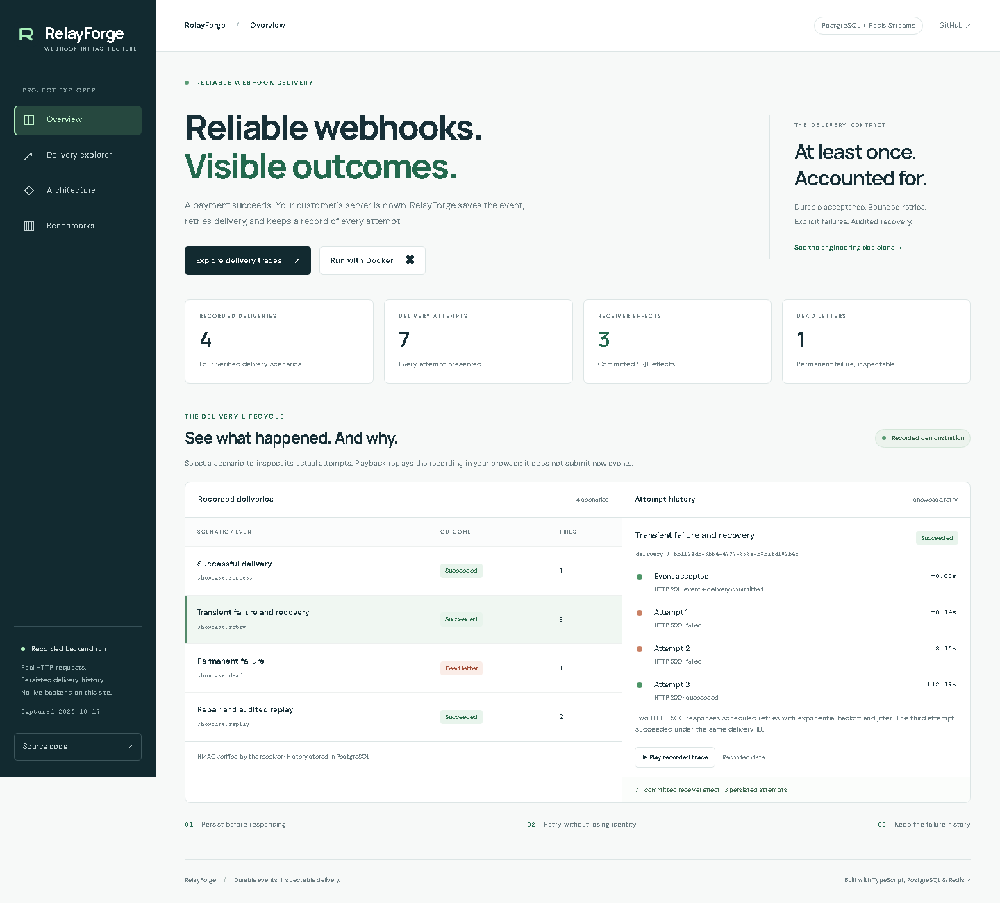
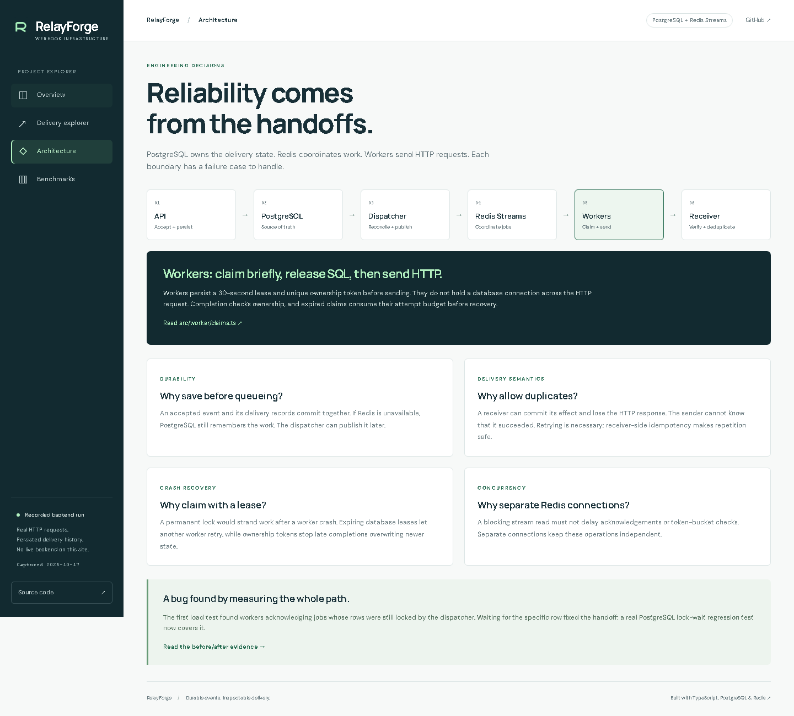
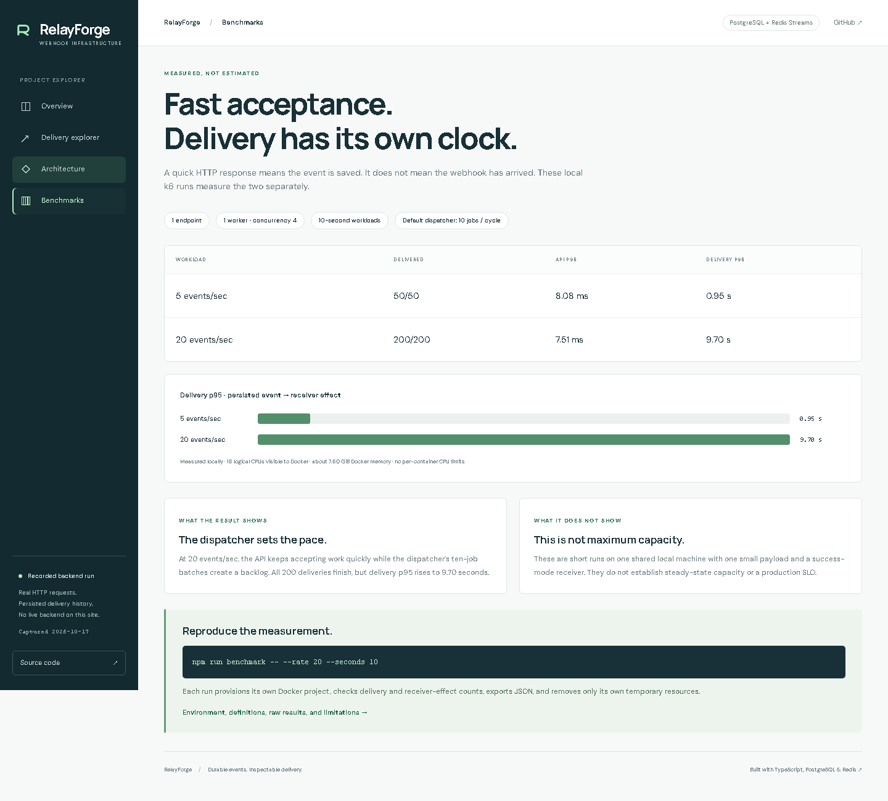

# RelayForge

A reliable webhook delivery platform for sending application events to HTTP endpoints.

RelayForge handles the delivery lifecycle: persisting events, routing them to subscribed endpoints, sending signed requests, retrying failures, and recovering interrupted work. Applications can submit events such as `payment.succeeded` or `order.shipped` and inspect delivery status and attempt history through the API.

[](https://github.com/FadyRafat0/RelayForge/actions/workflows/ci.yml)

**[Explore the recorded demo](https://fadyrafat0.github.io/RelayForge/) · [Design decisions](docs/design.md) · [Measured results](benchmarks/RESULTS.md) · [Run locally](#quick-start)**

## The problem

A payment succeeds, but the customer's webhook endpoint is unavailable. Sending directly from the payment request couples your application's response time to another service. Retrying from memory loses work on restart. A lost HTTP response introduces another problem: the receiver may have processed the event already.

RelayForge separates **durable acceptance** from **eventual delivery**. It remembers which endpoints must receive an event, retries transient failures, recovers interrupted attempts, and preserves an inspectable history. Permanent failures become dead deliveries that can be repaired and replayed with an audit trail.

## Project showcase

The static showcase lets visitors inspect real delivery histories, play recorded attempt timelines, explore architecture decisions, and compare API latency with delivery latency. It runs without a hosted database or worker. Traces were captured from actual isolated Docker runs and are explicitly labeled as recordings.

```sh
npm run showcase
```

Open http://127.0.0.1:4173/RelayForge/. The showcase is prepared for free GitHub Pages deployment; see [publishing and recording instructions](docs/showcase.md).

The public showcase is at **https://fadyrafat0.github.io/RelayForge/**. It presents recorded backend evidence, not an always-running webhook service.



<details>
<summary>Architecture and benchmark screenshots</summary>





</details>

## Features

- **Durable event ingestion:** events and matching delivery records are committed together in PostgreSQL.
- **Asynchronous delivery:** Redis Streams consumer groups distribute jobs across concurrent workers.
- **Automatic retries:** exponential backoff with jitter, Retry-After handling, and configurable attempt budgets.
- **Crash recovery:** durable worker leases, ownership tokens, and recovery of abandoned attempts.
- **Idempotency:** duplicate event submissions return the original event; the included receiver deduplicates repeated deliveries.
- **Signed webhooks:** HMAC-SHA256 signatures with timestamp verification.
- **Endpoint controls:** subscriptions, pause/resume, URL updates, and shared per-endpoint rate limits.
- **Dead-letter handling:** inspect failed deliveries and replay them with an audit trail.
- **Observability:** structured JSON logs, delivery metrics, and attempt history.
- **Reproducible testing:** integration tests, a configurable failure simulator, and isolated k6 benchmarks.

## Tech stack

| Component | Technology |
| --- | --- |
| Runtime and API | Node.js 24, TypeScript, Fastify |
| Persistence | PostgreSQL 18, node-postgres, SQL migrations |
| Queue and rate limiting | Redis 8, Redis Streams, Lua token buckets |
| Containers | Docker, Docker Compose |
| Testing and load testing | Vitest, k6 |
| CI | GitHub Actions |

## Architecture

```mermaid
flowchart LR
    Client -->|Register endpoint / submit event| API[Fastify API]
    API -->|One transaction: event + deliveries| PG[(PostgreSQL)]
    PG -->|Due pending deliveries| Dispatcher
    Dispatcher -->|Delivery IDs| Redis[(Redis Streams)]
    Redis -->|Consumer group| Workers[Bounded concurrent workers]
    Workers -->|Claim lease / record attempt and result| PG
    Workers -->|Shared token bucket| Redis
    Workers -->|Signed HTTP request| Receiver[Webhook receiver]
    Receiver -->|Receipt + example effect in one transaction| Inbox[(Receiver inbox)]
    Dispatcher -->|Recover expired leases| PG
    API -->|Inspection / replay / metrics| PG
```



PostgreSQL is the source of truth. Redis helps coordinate delivery but is not the only record of pending work. Publishing a job and committing its database marker cannot be one atomic transaction, so the dispatcher publishes first and tolerates duplicates. Workers use durable claims and ownership tokens; receivers must tolerate repeated HTTP requests. This is **at-least-once delivery**, with bounded retries and dead-letter inspection, not an exactly-once network guarantee. Delivery ordering is not guaranteed.

### Key design decisions

| Decision | Reason | Implementation |
| --- | --- | --- |
| Persist events and delivery obligations together | Avoid accepting an event without recording who must receive it | [Event transaction](src/events/store.ts) |
| Publish before recording queue markers | Prefer recoverable duplicate jobs over silently forgotten work | [Dispatcher](src/dispatch/batch.ts) |
| Use leases and ownership tokens | Recover worker crashes and reject stale completion writes | [Claims](src/worker/claims.ts), [completion](src/worker/completion.ts) |
| Release SQL connections before outbound HTTP | Slow endpoints must not occupy the database pool | [Worker processing](src/worker/process.ts) |
| Deduplicate at the receiver | The receiver may commit an effect before its HTTP reply is lost | [Transactional inbox](src/receiver/inbox.ts) |

An end-to-end load test exposed a row-lock race between publication and worker claims. The worker now waits for its specific delivery row instead of acknowledging skipped work. A real PostgreSQL/Redis regression test covers the handoff, and the [benchmark report](benchmarks/RESULTS.md) retains the failed pre-fix run. See [reliability design](docs/design.md) for invariants, crash windows, and tradeoffs.

## Quick start

Requires Docker Desktop with Linux containers, or Docker Engine with Compose on Linux.

```sh
docker compose -f compose.demo.yaml up -d --build --wait
```

Open http://127.0.0.1:3100/health. The stack starts the API, dispatcher, worker, PostgreSQL, Redis, and a signature-verifying receiver. Migrations and a demo endpoint are provisioned automatically, with a randomly generated secret. The demo uses its own named data volumes, separate from host development.

Linux:

```sh
curl -fsS http://127.0.0.1:3100/api/events -H 'Content-Type: application/json' \
  -d '{"type":"demo.event","payload":{"message":"Hello RelayForge"}}'
docker compose -f compose.demo.yaml logs --tail 20 worker receiver
```

PowerShell:

```powershell
$body = @{ type = 'demo.event'; payload = @{ message = 'Hello RelayForge' } } | ConvertTo-Json
Invoke-RestMethod http://127.0.0.1:3100/api/events -Method Post -ContentType application/json -Body $body
docker compose -f compose.demo.yaml logs --tail 20 worker receiver
```

The response confirms database acceptance. Worker/receiver logs show subsequent delivery. See the [Docker demo guide](docs/docker-demo.md) for networking, pause/resume, chaos modes, scaling, and lifecycle commands. Stop with `docker compose -f compose.demo.yaml down`; named volumes are retained.

## Local development

Requires Node.js 24, npm, and Docker. From the repository root:

```sh
npm ci
cp .env.example .env
npm run services:up
npm run db:migrate
npm run dev
```

In PowerShell, use `Copy-Item .env.example .env`. Keep an existing `.env` if already configured. These commands run PostgreSQL and Redis in Docker while the application runs on the host at http://127.0.0.1:3000. Run `npm run dispatcher` and `npm run worker` in separate terminals. For a host receiver, register an endpoint at `http://127.0.0.1:8080/webhooks`, set `RECEIVER_SIGNING_SECRET` to the returned secret, and run `npm run receiver`. Set `ALLOW_LOOPBACK_ENDPOINTS=true` in the worker terminal for this local destination. The default worker allows public destinations only.

## API

| Method and path | Purpose |
| --- | --- |
| `GET /health` | API and PostgreSQL connectivity (`SELECT 1`); 503 on database failure |
| `GET /metrics` | Database-wide Prometheus gauges; 503 if unavailable |
| `POST /api/endpoints` | Register URL, subscriptions, enabled state, rate limit; returns signing secret once |
| `GET /api/endpoints` | Paginated endpoint list without secrets |
| `PATCH /api/endpoints/:id` | Update supplied fields, including pause/resume; omitted fields stay unchanged |
| `POST /api/events` | Persist an event and matching deliveries atomically; supports idempotency key |
| `GET /api/deliveries/dead` | Paginated dead-letter inspection |
| `GET /api/deliveries/:id` | State, latest attempt, and latest replay |
| `GET /api/deliveries/:id/attempts` | Paginated attempt history |
| `POST /api/deliveries/:id/replay` | Audited replay of dead work with an expected attempt count |

An event request is `{ "type": "payment.succeeded", "payload": { "amount": 100 }, "idempotency_key": "payment-123" }`. The same key and data return the original event (200); changed data return 409. New events return 201, including the number of matching deliveries. Zero matches is valid. Subscriptions use exact case-sensitive event types or `*`.

Pausing prevents matching new events and future claims; requests already in progress may finish. Pending work remains durable and resumes through reconciliation after enabling. Endpoint edits affect future claims, including retries of older events. No deletion endpoint removes delivery history.

## Reliability behavior

- Redis consumer groups and idle-job reclaim coordinate workers. Database claims, 30-second leases, fencing tokens, and abandoned-attempt recovery handle duplicate jobs and worker crashes.
- HTTP requests have a five-second deadline, bounded response bodies, validated and pinned DNS addresses, and no redirects. Private/link-local addresses are blocked; loopback requires an explicit development flag.
- Transient failures use exponential backoff with equal jitter, capped at five minutes. HTTP 429/503 honor valid Retry-After minimums. Permanent failures and exhausted budgets become dead; replay preserves history and identity.
- HMAC-SHA256 signatures cover raw bytes and delivery metadata, with timestamp freshness checks. The example receiver atomically records its receipt and SQL effect, so identical repeated deliveries do not apply the effect twice.
- Redis token buckets apply a shared per-endpoint limit across workers. Denied admission defers work without consuming an attempt. Redis admission failures leave work unacknowledged.
- Bounded concurrency defaults to four jobs per worker (configurable 1..16). Separate blocking-read, acknowledgement, and limiter connections avoid Redis head-of-line blocking.
- JSON logs correlate event, delivery, attempt, and stream IDs without recording payloads or signing secrets. Metrics expose delivery states, outcomes, due-work lag, expired leases, and replays.

## Database and code layout

`webhook_endpoints` describes destinations. `events` stores accepted source data. `deliveries` stores one obligation per event/endpoint pair. `delivery_attempts` records each try. `delivery_replays` audits manual intervention. `receiver_receipts` and `receiver_effects` belong to the example consumer and demonstrate transactional deduplication. Foreign keys, unique constraints, checks, and indexes enforce these relationships. Numbered SQL migrations are checksum-verified; add a new migration instead of changing applied SQL.

```text
src/endpoints, events, deliveries   HTTP routes and parameterized SQL stores
src/dispatch, queue                Durable dispatch and Redis Streams adapters
src/worker                        Claims, HTTP, retries, recovery, limits, concurrency
src/receiver, webhooks             Chaos simulator, inbox, HMAC signing/verification
src/observability                 Structured logging and Prometheus output
migrations/                       Immutable versioned SQL
test/                             Fast tests, real PostgreSQL/Redis integration tests
benchmarks/                       k6 workload, isolated runner, measured reports
showcase/                         Static explorer with recorded backend evidence
scripts/                          Trace recording, local preview, browser checks
.github/workflows/ci.yml           Linux correctness checks and Docker delivery smoke
```

## Testing

```sh
npm run typecheck
npm test
npm run services:up
npm run db:migrate
npm run test:integration
npm run build
```

Integration tests use isolated PostgreSQL schemas and uniquely named Redis keys; they require real services and do not truncate application data. GitHub Actions runs type checking, both test suites, migrations, the build, and a complete Docker delivery smoke test.

## Benchmarks

Run an isolated workload with k6:

```sh
npm run benchmark -- --rate 5 --seconds 10
```

Recorded local results for one endpoint and one worker process with concurrency four:

| Offered load | Successful deliveries | API ingestion p95 | Delivery p95 |
| --- | ---: | ---: | ---: |
| 5 events/sec for 10 seconds | 50/50 | 8.08 ms | 952 ms |
| 20 events/sec for 10 seconds | 200/200 | 7.51 ms | 9.70 sec |

The benchmark runner creates a separate Compose project, verifies successful deliveries and receiver effects, exports results, and removes its temporary resources. API ingestion latency measures HTTP response time; delivery latency uses persisted event and receiver-effect timestamps. The higher-load run shows queue buildup at the default dispatcher batch/poll settings. These short local measurements are not maximum-capacity estimates. See [full results and environment](benchmarks/RESULTS.md) and [benchmark configuration](docs/load-testing.md).

## Documentation

| Topic | References |
| --- | --- |
| Design and project showcase | [Reliability decisions](docs/design.md), [recording and free hosting](docs/showcase.md) |
| Data and API | [Database schema](docs/database.md), [endpoints](docs/endpoint-api.md), [event ingestion](docs/event-ingestion.md) |
| Delivery processing | [Dispatch](docs/redis-dispatch.md), [workers](docs/worker.md), [retries](docs/retries.md), [leases and recovery](docs/worker-leases.md) |
| Signatures and recovery | [HMAC signing](docs/signatures.md), [receiver deduplication](docs/receiver-deduplication.md), [dead-letter replay](docs/dead-deliveries.md) |
| Runtime and operations | [Rate limits](docs/rate-limits.md), [concurrency](docs/worker-concurrency.md), [observability](docs/observability.md), [CI](docs/ci.md) |
| Deployment and benchmarks | [Docker demo](docs/docker-demo.md), [load testing](docs/load-testing.md), [measured results](benchmarks/RESULTS.md) |

## Current limitations

- The API currently serves a single project without authentication or tenant isolation. The supplied Compose setup exposes it on host loopback.
- Delivery is at least once and unordered. Receiver deduplication covers the included SQL effect; external side effects need their own idempotency strategy.
- SQL history and Redis Stream entries have no automatic retention policy. Current metrics scan retained history.
- The default dispatcher publishes up to ten jobs per batch and sleeps one second between cycles, limiting sustained delivery throughput.
- The demo receiver shares PostgreSQL with the sender. Independent consumers would manage their own storage and signing secrets.

Public deployment also requires authentication, TLS termination, secret management, backups, and operational configuration.
